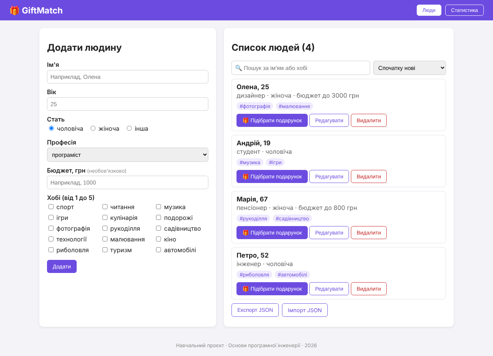

# GiftMatch 🎁

**Веб-застосунок, який допомагає підібрати подарунок для людини на основі її хобі, віку, статі та професії.**

Навчальний проєкт з дисципліни «Основи програмної інженерії».
Автор: [ПІБ студента], група [номер групи], 2026.



## Про проєкт

Багато людей не знають, що подарувати. GiftMatch пропонує ввести кілька фактів про людину і одразу показує 5 найкращих подарунків з відсотком відповідності та кнопками, щоб купити їх на маркетплейсі.

Як працює підбір: кожна характеристика має свій **коефіцієнт** (вагу). Найбільша вага в хобі.

| Характеристика | Коефіцієнт |
|---|---|
| Хобі | 0.45 |
| Вік | 0.25 |
| Професія | 0.20 |
| Стать | 0.10 |

```
бал = 0.45 × хобі + 0.25 × вік + 0.20 × професія + 0.10 × стать   (від 0 до 100%)
```

Кожна характеристика оцінюється від 0 до 1:

| Характеристика | Як рахується оцінка |
|---|---|
| Хобі | немає збігів → 0; подарунок універсальний → 0.3; є збіг → `0.4 + 0.3 × покриття + 0.3 × точність`, де *покриття* — яка частина хобі людини збіглася, *точність* — яка частина хобі подарунка збіглася |
| Вік | у межах діапазону подарунка → від 0.5 до 1 (1 — якщо вік у середині діапазону); до 5 років за межами → 0.25; інакше → 0 |
| Професія | збіг → 1; інакше → 0.3 |
| Стать | підходить або подарунок для всіх → 1; інакше → 0 |

Приклад: Олена, 25, дизайнер, хобі малювання і фотографія → «Скетчбук і маркери» **89%**, «Графічний планшет» **80%**, «Штатив для телефону» **74%**.

Як продукт заробляє: посилання на Rozetka, Prom.ua і Allo містять партнерську мітку `utm_source=giftmatch`. За переходи і покупки з такою міткою маркетплейси платять власнику сервісу. Статистику переходів видно на сторінці «Статистика».

## Можливості

- додавання, перегляд, редагування і видалення людей
- перевірка введених даних з зрозумілими повідомленнями
- збереження в браузері (localStorage) — дані не зникають після перезавантаження
- пошук за ім'ям або хобі, сортування (за ім'ям, віком, датою)
- підбір топ-5 подарунків з каталогу (50 подарунків) з відсотком і причинами
- **бюджет** — показуються тільки подарунки, які вкладаються в суму (v1.1)
- кнопки маркетплейсів: Rozetka, Prom.ua, Allo
- статистика: кількість людей, найпопулярніше хобі, переходи на маркетплейси
- експорт і імпорт списку людей у JSON-файл
- адаптивний дизайн для телефону

## Технології

- TypeScript
- Vite (збірка і локальний сервер)
- Vitest (автоматичні тести)
- HTML, CSS
- localStorage для збереження даних

## Встановлення та запуск

Потрібно: [Node.js](https://nodejs.org/) версії 18 або новіше.

```bash
git clone https://github.com/[ваш-логін]/gift-match.git
cd gift-match
npm install
npm run dev
```

Відкрити в браузері адресу, яку покаже Vite (зазвичай http://localhost:5173).

Інші команди:

| Команда | Що робить |
|---|---|
| `npm test` | запускає автотести (26 тестів) |
| `npm run build` | перевіряє типи і збирає сайт у папку `dist/` |
| `npm run preview` | показує зібрану версію |

## Структура проєкту

```
gift-match/
├── index.html           # розмітка сторінки
├── src/
│   ├── main.ts          # інтерфейс
│   ├── style.css
│   ├── types.ts         # типи даних
│   ├── storage.ts       # PersonStore - збереження людей
│   ├── validation.ts    # перевірка даних
│   ├── recommender.ts   # алгоритм підбору
│   ├── marketplaces.ts  # посилання на маркетплейси
│   ├── stats.ts         # статистика
│   ├── utils.ts         # escapeHtml
│   └── data/            # каталог подарунків, довідники
├── tests/               # автотести
└── docs/                # звіти, User Manual, презентація
```

## Документація

- [Інструкція користувача (User Manual)](docs/USER_MANUAL.md)
- [Презентація](docs/PRESENTATION.md)

Звіти з практичних робіт:

| № | Тема |
|---|---|
| 1 | [Project Vision](docs/01-project-vision.md) |
| 2 | [Аналіз проблеми і предметної області](docs/02-problem-and-domain.md) |
| 3 | [Життєвий цикл ПЗ](docs/03-software-lifecycle.md) |
| 4 | [Вимоги до програмного продукту](docs/04-requirements.md) |
| 5 | [User Stories та критерії приймання](docs/05-user-stories.md) |
| 6 | [Use Case Diagram](docs/06-use-cases.md) |
| 7 | [Class Diagram](docs/07-class-diagram.md) |
| 8 | [Прототип інтерфейсу](docs/08-ui-prototype.md) |
| 9 | [Основи Git та GitHub](docs/09-git-basics.md) |
| 10 | [Командна робота з Git](docs/10-git-teamwork.md) |
| 11 | [Архітектура](docs/11-architecture.md) |
| 12 | [MVP і план](docs/12-mvp-plan.md) |
| 13 | [Початок розробки](docs/13-development-start.md) |
| 14 | [Реалізація та інтеграція](docs/14-implementation-integration.md) |
| 15 | [Ручне тестування](docs/15-manual-testing.md) |
| 16 | [Автоматизоване тестування](docs/16-automated-testing.md) |
| 17 | [Управління проєктом](docs/17-project-management.md) |
| 18 | [Пошук і виправлення помилок](docs/18-bugs-and-issues.md) |
| 19 | [Зміна вимог](docs/19-change-request.md) |
| 20 | [Документування та презентація](docs/20-documentation-presentation.md) |

## Версії

| Версія | Що нового |
|---|---|
| v0.1.0 | перша робоча версія: додавання людей |
| v0.2.0 | функціональний прототип: підбір, маркетплейси, редагування, пошук, статистика, імпорт/експорт |
| v1.0.0 | автотести, виправлені помилки BUG-0…BUG-3 |
| v1.1.0 | бюджет (нова вимога) |
| v1.1.1 | точніший рейтинг: подарунки більше не отримують однаковий відсоток (BUG-5) |

## Обмеження

- каталог подарунків вбудований у код, ціни орієнтовні;
- дані зберігаються тільки в одному браузері (для перенесення — експорт/імпорт);
- партнерська мітка навчальна (UTM), без реальної партнерської програми.
