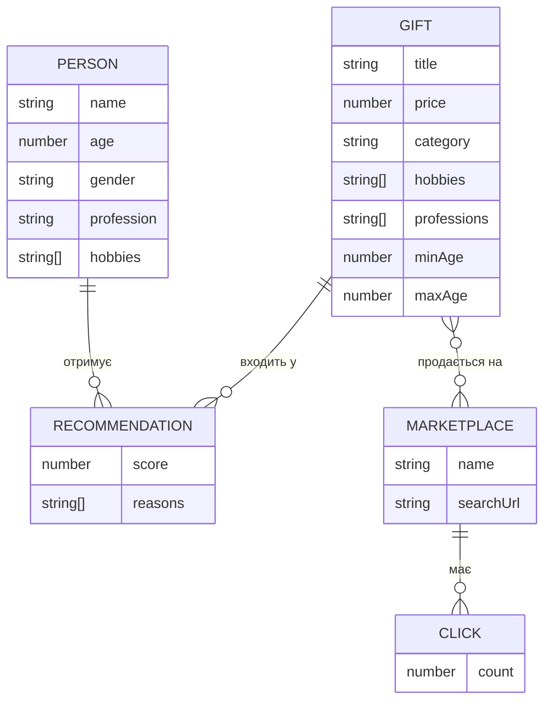

# Практична робота №2. Аналіз проблеми, користувачів та предметної області

## Мета

Навчитися аналізувати проблему, для якої створюється програмний продукт, та визначати особливості предметної області.

## Хід роботи

### 1. Формулювання проблеми

Людина хоче зробити гарний подарунок, але:
- не знає, що саме подарувати;
- витрачає багато часу на пошук ідей в інтернеті;
- в інтернет-магазинах треба вже знати, що шукаєш;
- часто дарує «щось загальне», що не враховує інтереси людини.

**Коротко:** немає простого інструменту, який за інформацією про людину сам запропонує відповідні подарунки і покаже, де їх купити.

### 2. Потреби користувачів

| № | Потреба |
|---|---|
| 1 | Швидко отримати кілька ідей подарунка |
| 2 | Щоб ідеї враховували хобі, вік, стать і професію людини |
| 3 | Бачити, наскільки подарунок підходить (наприклад, у відсотках) |
| 4 | Відразу перейти в магазин і купити подарунок |
| 5 | Зберегти список людей (друзі, родичі), щоб не вводити дані кожного разу |
| 6 | Знайти людину в списку, якщо їх багато |

### 3. Цільова аудиторія

| Група | Опис | Що для них важливо |
|---|---|---|
| Студенти / молодь 16–25 | дарують подарунки друзям, обмежений бюджет | швидкість, ідеї |
| Дорослі 25–45 | дарують батькам, дітям, колегам | економія часу, якість |
| Офісні працівники | подарунки колегам від колективу | нейтральні подарунки за професією |

### 4. Основні об'єкти предметної області

| Об'єкт | Опис | Основні атрибути |
|---|---|---|
| **Отримувач (Person)** | людина, якій шукаємо подарунок | ім'я, вік, стать, професія, хобі |
| **Подарунок (Gift)** | товар з каталогу | назва, опис, ціна, категорія, для яких хобі/професій/віку/статі підходить |
| **Рекомендація (Recommendation)** | подарунок, підібраний для конкретної людини | подарунок, бал (0–100%), причини |
| **Маркетплейс (Marketplace)** | інтернет-магазин, де можна купити подарунок | назва, адреса пошуку |
| **Перехід (Click)** | факт переходу користувача на маркетплейс | маркетплейс, кількість переходів |
| **Коефіцієнт (Weight)** | важливість характеристики при підборі | хобі 0.45, вік 0.25, професія 0.20, стать 0.10 |

### 5. Взаємозв'язки між об'єктами

- Один **Отримувач** має одне або декілька **хобі**.
- Один **Подарунок** може підходити для кількох хобі, кількох професій, певного діапазону віку і певної статі.
- Для одного **Отримувача** система створює кілька **Рекомендацій** (до 5).
- Кожна **Рекомендація** містить один **Подарунок**.
- Один **Подарунок** можна шукати на кількох **Маркетплейсах**.
- На кожен **Маркетплейс** фіксується кількість **Переходів**.

### 6. Основні сценарії використання

1. Користувач додає людину (ім'я, вік, стать, професія, хобі).
2. Користувач переглядає список доданих людей.
3. Користувач змінює дані людини (наприклад, у неї з'явилось нове хобі).
4. Користувач видаляє людину зі списку.
5. Користувач шукає людину за ім'ям або хобі.
6. Користувач натискає «Підібрати подарунок» і бачить топ-5 подарунків з відсотком.
7. Користувач натискає на кнопку маркетплейсу і переходить на сторінку пошуку цього товару.
8. Користувач дивиться статистику переходів на маркетплейси.

### 7. Межі системи

**Що входить у систему:**
- зберігання списку людей у браузері;
- каталог подарунків (вбудований у програму);
- алгоритм підбору з коефіцієнтами;
- посилання на маркетплейси з партнерською міткою;
- статистика переходів.

**Що НЕ входить у систему:**
- оплата і покупка товару (це робить маркетплейс);
- реєстрація і вхід користувачів;
- сервер і база даних (все зберігається в браузері);
- реальні ціни з маркетплейсів (у каталозі вказана орієнтовна ціна);
- доставка.

## Результат

Описано проблему, потреби і цільову аудиторію, основні об'єкти предметної області та зв'язки між ними, основні сценарії і межі системи.

## Висновок

На цій роботі я навчився аналізувати предметну область. Я зрозумів, що перед написанням коду треба чітко визначити, з якими об'єктами буде працювати програма і що програма робити не буде. Це допоможе не «розтягувати» проєкт і зробити його вчасно.
