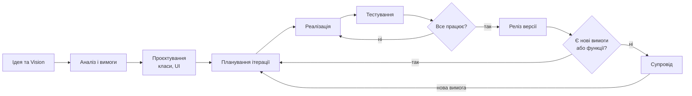

# Практична робота №3. Життєвий цикл програмного забезпечення

## Мета

Ознайомитися з моделями життєвого циклу програмного забезпечення та навчитися обирати відповідну модель для власного проєкту.

## Хід роботи

### 1. Основні моделі життєвого циклу

**Каскадна модель (Waterfall)** — етапи йдуть строго один за одним: вимоги → проєктування → реалізація → тестування → впровадження → супровід. Повернутися на попередній етап складно.

**V-модель** — схожа на каскадну, але для кожного етапу розробки одразу планується відповідний етап тестування (вимоги ↔ приймальне тестування, проєктування ↔ інтеграційне тестування і т.д.).

**Ітераційна (інкрементна) модель** — програма робиться частинами. Спочатку робиться мінімальна версія, потім у кожній ітерації додаються нові функції.

**Спіральна модель** — розробка йде по «витках», і на кожному витку аналізуються ризики. Підходить для великих і ризикованих проєктів.

**Гнучкі методології (Agile: Scrum, Kanban)** — робота короткими ітераціями (спринтами), часте отримання зворотного зв'язку, вимоги можуть змінюватися.

### 2. Порівняння моделей

| Модель | Плюси | Мінуси | Коли підходить |
|---|---|---|---|
| Waterfall | проста, зрозуміла, багато документації | важко вносити зміни, результат видно тільки в кінці | вимоги точно відомі і не зміняться |
| V-модель | тестування планується з самого початку | теж погано з змінами | системи, де важлива надійність (медицина) |
| Ітераційна | швидко є робоча версія, можна додавати функції | треба добре планувати ітерації | середні проєкти, вимоги можуть доповнюватись |
| Спіральна | контроль ризиків | складна, дорога | великі ризиковані проєкти |
| Agile (Kanban/Scrum) | гнучкість, швидкий результат | менше документації, потрібна дисципліна | невеликі команди, вимоги змінюються |

### 3. Особливості обраної моделі

Я обрав **ітераційну (інкрементну) модель з елементами Kanban**.

Особливості:
- спочатку роблю **MVP** — мінімальну робочу версію (додавання людей + підбір подарунків);
- далі в кожній ітерації додаю нові функції (пошук, статистика, імпорт/експорт, бюджет);
- задачі веду на Kanban-дошці (To Do → In Progress → Done);
- після кожної ітерації тестую програму.

### 4. Вибір моделі для проєкту

**Модель: ітераційна + Kanban.**

### 5. Етапи життєвого циклу мого проєкту

| Ітерація | Етапи | Результат |
|---|---|---|
| 0. Підготовка | ідея, аналіз, вимоги, проєктування, макети | документи (практичні 1–8) |
| 1. MVP | налаштування репозиторію, структура, додавання людини, список, підбір подарунків | перша робоча версія |
| 2. Розширення | редагування, видалення, пошук, маркетплейси, статистика, імпорт/експорт | функціональний прототип |
| 3. Якість | ручне і автоматичне тестування, виправлення помилок | версія 1.0 |
| 4. Супровід | нова вимога (бюджет), оновлення тестів і документації | версія 1.1 |

### 6. Схема життєвого циклу

### 7. Обґрунтування вибору

1. **Я працюю сам** — мені не потрібні складні процеси, як у Scrum (ролі Scrum Master, щоденні мітинги).
2. **Вимоги можуть змінюватися** — наприклад, викладач у практичній №19 дасть нову вимогу. В каскадній моделі це було б складно.
3. **Швидко є результат** — після першої ітерації вже можна показати робочу програму.
4. **Kanban-дошка** допомагає бачити, що зроблено і що залишилось (це буде в практичній №17).
5. **Тестування після кожної ітерації** — помилки знаходяться раніше, а не в самому кінці.

Каскадна модель не підходить, бо в мене навчальний проєкт і я не можу на початку знати всі деталі. Спіральна модель занадто складна для такого маленького проєкту.

## Результат

Схема життєвого циклу проєкту GiftMatch + обґрунтування вибору ітераційної моделі з Kanban.

## Висновок

Я розглянув основні моделі життєвого циклу ПЗ і порівняв їх. Для свого проєкту обрав ітераційну модель, бо вона дозволяє швидко отримати робочу версію і потім поступово її покращувати.
