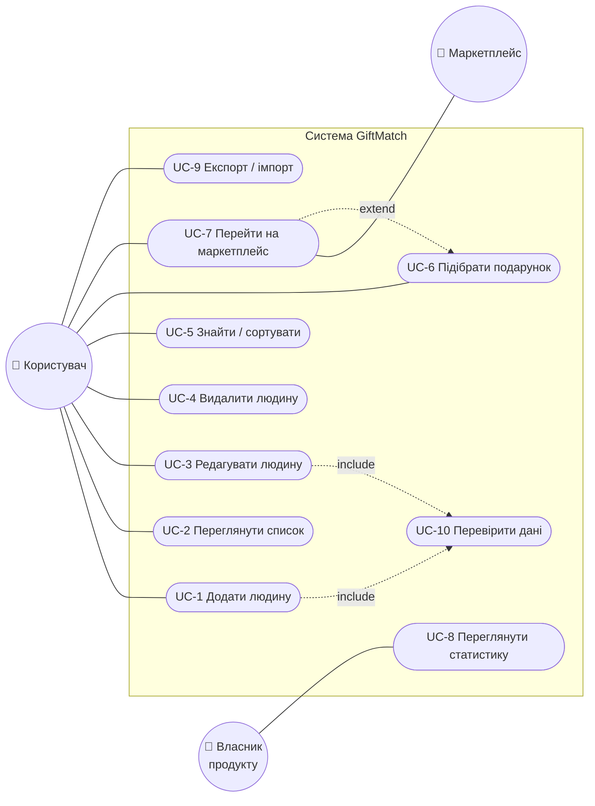

# Практична робота №6. Аналіз предметної області та Use Case Diagram

## Мета

Навчитися моделювати взаємодію користувачів із програмним продуктом.

## Хід роботи

### 1. Актори системи

| Актор | Тип | Опис |
|---|---|---|
| **Користувач** | основний | людина, яка шукає подарунок |
| **Маркетплейс** | зовнішня система | Rozetka / Prom.ua / Allo — приймає переходи з посилань |
| **Власник продукту** | другорядний | дивиться статистику переходів (у першій версії це той самий інтерфейс) |

### 2. Основні сценарії (Use Cases)

| ID | Use Case | Актор |
|---|---|---|
| UC-1 | Додати людину | Користувач |
| UC-2 | Переглянути список людей | Користувач |
| UC-3 | Редагувати людину | Користувач |
| UC-4 | Видалити людину | Користувач |
| UC-5 | Знайти / відсортувати людей | Користувач |
| UC-6 | Підібрати подарунок | Користувач |
| UC-7 | Перейти на маркетплейс | Користувач, Маркетплейс |
| UC-8 | Переглянути статистику | Власник продукту |
| UC-9 | Експорт / імпорт списку | Користувач |
| UC-10 | Перевірити введені дані | (включається в UC-1, UC-3) |

### 3. Use Case Diagram

> Діаграма зроблена в Mermaid (GitHub її показує як картинку). Овали — це сценарії, прямокутник — межі системи.

### 4. Зв'язки між акторами та сценаріями

- **Користувач** пов'язаний з UC-1 … UC-7 і UC-9 — це все, що він робить у програмі.
- **Власник продукту** пов'язаний з UC-8 — його цікавить статистика переходів.
- **Маркетплейс** пов'язаний з UC-7 — він отримує перехід користувача.
- **include** (обов'язково включає): UC-1 і UC-3 завжди включають UC-10 «Перевірити дані» — без перевірки людину не можна зберегти.
- **extend** (розширює): UC-7 «Перейти на маркетплейс» розширює UC-6 — після підбору подарунка користувач *може* перейти в магазин, але не обов'язково.

### 5. Опис основних Use Cases

#### UC-1. Додати людину

| Поле | Опис |
|---|---|
| Актор | Користувач |
| Передумови | Відкрита сторінка «Люди» |
| Основний сценарій | 1. Користувач вводить ім'я. 2. Вводить вік. 3. Обирає стать. 4. Обирає професію зі списку. 5. Відмічає від 1 до 5 хобі. 6. Натискає «Додати». 7. Система перевіряє дані (UC-10). 8. Система зберігає людину в localStorage. 9. Людина з'являється у списку, форма очищується. |
| Альтернативний сценарій | 7a. Дані неправильні → система показує список помилок над формою, людина не зберігається. Користувач виправляє і повертається до кроку 6. |
| Результат | Нова людина є у списку. |

#### UC-6. Підібрати подарунок

| Поле | Опис |
|---|---|
| Актор | Користувач |
| Передумови | У списку є хоча б одна людина |
| Основний сценарій | 1. Користувач натискає «🎁 Підібрати подарунок» на картці людини. 2. Система для кожного подарунка з каталогу рахує бал: хобі × 0.45 + вік × 0.25 + професія × 0.20 + стать × 0.10. 3. Система сортує подарунки за балом. 4. Система показує топ-5: назва, опис, ціна, відсоток, причини, кнопки маркетплейсів. 5. Користувач переглядає результат і може натиснути «← Назад». |
| Альтернативний сценарій | 3a. Жоден подарунок не підходить (бал 0) → система показує «На жаль, нічого не знайдено». |
| Результат | Користувач бачить найкращі подарунки. |

#### UC-7. Перейти на маркетплейс

| Поле | Опис |
|---|---|
| Актори | Користувач, Маркетплейс |
| Передумови | Показані рекомендації (UC-6) |
| Основний сценарій | 1. Користувач натискає кнопку маркетплейсу (наприклад «Rozetka»). 2. Система збільшує лічильник переходів для цього маркетплейсу. 3. Система відкриває в новій вкладці посилання пошуку з назвою подарунка і міткою `utm_source=giftmatch`. 4. Маркетплейс показує результати пошуку. |
| Альтернативний сценарій | 3a. Браузер заблокував нову вкладку → користувач дозволяє спливаючі вікна і натискає ще раз. |
| Результат | Користувач на сторінці маркетплейсу, перехід зарахований. |

## Результат

Use Case Diagram + опис трьох основних сценаріїв.

## Висновок

Я навчився визначати акторів і сценарії використання та малювати Use Case діаграму. Я зрозумів різницю між include (завжди виконується) і extend (може виконуватись). Діаграма допомогла побачити всю систему «зверху» на одній картинці.
