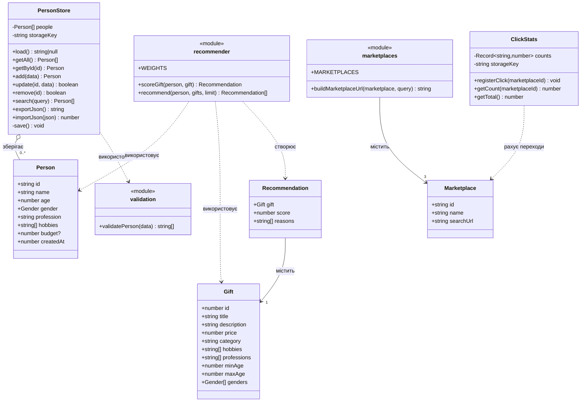

# Практична робота №7. Проєктування структури програмного забезпечення

## Мета

Сформувати розуміння структури майбутнього програмного продукту та взаємодії його основних компонентів.

## Хід роботи

### 1. Основні компоненти системи

| Компонент | Файл | Що робить |
|---|---|---|
| Інтерфейс (UI) | `src/main.ts`, `index.html`, `src/style.css` | показує сторінки, форму, список, обробляє натискання кнопок |
| Сховище людей | `src/storage.ts` | додає, змінює, видаляє, шукає людей, зберігає в localStorage |
| Перевірка даних | `src/validation.ts` | перевіряє ім'я, вік, стать, професію, хобі |
| Алгоритм підбору | `src/recommender.ts` | рахує бал подарунка з коефіцієнтами і вибирає топ-5 |
| Маркетплейси | `src/marketplaces.ts` | список маркетплейсів і створення посилань з міткою |
| Статистика | `src/stats.ts` | рахує переходи на маркетплейси, найпопулярніше хобі |
| Каталог подарунків | `src/data/gifts.ts` | масив подарунків |
| Довідники | `src/data/options.ts` | списки хобі і професій |
| Типи | `src/types.ts` | інтерфейси Person, Gift, Recommendation, Marketplace |

### 2. Відповідальність компонентів

Я намагався зробити так, щоб кожен файл відповідав тільки за одну річ:
- `recommender.ts` нічого не знає про HTML і localStorage — тільки рахує бали. Тому його легко тестувати.
- `storage.ts` нічого не знає про HTML — тільки працює з даними.
- `main.ts` не рахує бали сам, а викликає `recommend()`.

### 3. Основні сутності

- **Person** — людина, якій шукаємо подарунок.
- **Gift** — подарунок з каталогу.
- **Recommendation** — подарунок + бал + причини.
- **Marketplace** — маркетплейс.

### 4. Класи

| Клас / модуль | Тип | Основні методи |
|---|---|---|
| `PersonStore` | клас | `load()`, `getAll()`, `getById()`, `add()`, `update()`, `remove()`, `search()`, `exportJson()`, `importJson()` |
| `ClickStats` | клас | `registerClick()`, `getCount()`, `getTotal()` |
| `recommender` | модуль з функціями | `scoreGift()`, `recommend()`, константа `WEIGHTS` |
| `validation` | модуль з функціями | `validatePerson()` |
| `marketplaces` | модуль з функціями | `buildMarketplaceUrl()`, константа `MARKETPLACES` |

У TypeScript не обов'язково все робити класами, тому для алгоритму і перевірки я зробив просто функції в окремих файлах (модулях). На діаграмі вони позначені як `<<module>>`.

### 5. Зв'язки між класами

- `PersonStore` **зберігає** багато об'єктів `Person` (агрегація 1 → 0..*).
- `recommend()` **використовує** `Person` і масив `Gift` і **створює** `Recommendation`.
- `Recommendation` **містить** один `Gift`.
- `PersonStore` **використовує** `validatePerson()` під час імпорту.
- `ClickStats` **рахує** переходи для `Marketplace` (за `id`).

### 6. Спрощена Class Diagram

### 7. Основні проєктні рішення

1. **Без сервера.** Дані зберігаються в localStorage браузера. Це простіше для першої версії і дані користувача нікуди не передаються (NFR-6).
2. **Каталог подарунків — у коді.** Масив у файлі `gifts.ts`. Для навчального проєкту не потрібна база даних.
3. **Хобі і професії — зі списку, а не довільний текст.** Інакше «Музика», «музика» і «музыка» були б різними хобі і алгоритм би їх не порівняв.
4. **Коефіцієнти в одному місці** (константа `WEIGHTS`), щоб їх було легко змінити.
5. **Логіка окремо від інтерфейсу.** Функції підбору і перевірки не працюють з HTML, тому їх можна перевірити автоматичними тестами.
6. **Маркетплейси — через посилання на пошук.** У нас немає доступу до API маркетплейсів, тому ми відкриваємо сторінку пошуку з назвою подарунка і партнерською міткою.

> **Оновлено у версії 1.1:** у `Person` додано необов'язкове поле `budget` (практична №19). Під час виправлення BUG-3 додано модуль `utils.ts` з функцією `escapeHtml()` (практична №18), а в `storage.ts` — функцію `sortPeople()` (практична №14).

## Результат

Class Diagram + опис структури програми.

## Висновок

Я визначив компоненти системи, основні класи і зв'язки між ними. Я зрозумів, що краще розділяти логіку і інтерфейс, тоді код легше тестувати і змінювати.
