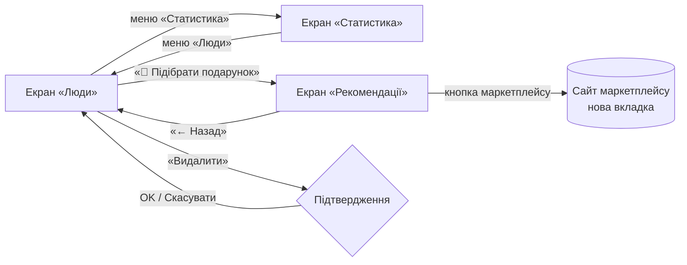

# Практична робота №8. Проєктування інтерфейсу користувача

## Мета

Навчитися проєктувати зручну взаємодію користувача з програмним продуктом.

## Хід роботи

### 1. Основні екрани

| № | Екран | Що на ньому є |
|---|---|---|
| 1 | **Люди** (головний) | шапка з меню, форма додавання/редагування, список людей з пошуком і сортуванням, кнопки експорт/імпорт |
| 2 | **Рекомендації** | ім'я людини, топ-5 подарунків з відсотком, причини, кнопки маркетплейсів, кнопка «Назад» |
| 3 | **Статистика** | кількість людей, найпопулярніше хобі, переходи на кожен маркетплейс |
| 4 | Вікно підтвердження | «Видалити [ім'я]?» — стандартне вікно браузера |

### 2. Навігація

У шапці є два пункти меню: **«Люди»** і **«Статистика»**. На екран «Рекомендації» потрапляємо з картки людини, а повертаємось кнопкою «← Назад».



### 3. Основні користувацькі сценарії в інтерфейсі

**Сценарій А: «Підібрати подарунок другу»**
1. Відкрити сайт → екран «Люди».
2. Заповнити форму зліва → «Додати».
3. На картці друга в списку натиснути «🎁 Підібрати подарунок».
4. Екран «Рекомендації» → натиснути «Rozetka» біля подарунка → відкривається Rozetka.

**Сценарій Б: «Змінити хобі»**
1. На картці натиснути «Редагувати» → дані з'являються у формі.
2. Змінити хобі → «Зберегти зміни».

**Сценарій В: «Подивитися статистику»**
1. У меню натиснути «Статистика».

### 4. Прототип (каркаси екранів)

Спочатку я намалював каркаси (wireframes) схематично, а потім зробив прототип у Figma.

**Екран 1 — Люди**
```
+----------------------------------------------------------------+
|  🎁 GiftMatch                         [ Люди ]  [ Статистика ]  |
+----------------------------------------------------------------+
|  ДОДАТИ ЛЮДИНУ               |  СПИСОК ЛЮДЕЙ (3)                |
|                              |  [🔍 Пошук за ім'ям або хобі ]   |
|  Ім'я:   [____________]      |  Сортування: [Спочатку нові ▼]   |
|  Вік:    [___]               |  +----------------------------+  |
|  Стать:  (•) чол ( ) жін ( ) інша | Олена, 25               |  |
|  Професія: [дизайнер    ▼]   |  | дизайнер                   |  |
|  Хобі (1–5):                 |  | #малювання #фотографія     |  |
|  [x] спорт   [ ] читання     |  | [🎁 Підібрати] [Ред.] [Вид.]|  |
|  [ ] музика  [x] ігри  ...   |  +----------------------------+  |
|                              |  +----------------------------+  |
|  [  Додати  ]                |  | Петро, 52 ...              |  |
|                              |  +----------------------------+  |
|                              |  [Експорт JSON] [Імпорт JSON]    |
+----------------------------------------------------------------+
```

**Екран 2 — Рекомендації**
```
+----------------------------------------------------------------+
|  🎁 GiftMatch                         [ Люди ]  [ Статистика ]  |
+----------------------------------------------------------------+
|  [← Назад]   Подарунки для: Олена (25, дизайнер)                |
|                                                                 |
|  1. Графічний планшет                       ███████████░  92%  |
|     Для малювання на комп'ютері.     ~ 2500 грн                |
|     ✓ Підходить під хобі: малювання                            |
|     ✓ Вік у межах 14–60                                        |
|     ✓ Підходить для професії: дизайнер                         |
|     Купити: [Rozetka] [Prom.ua] [Allo]                         |
|  -------------------------------------------------------------  |
|  2. ...                                                         |
+----------------------------------------------------------------+
```

**Екран 3 — Статистика**
```
+----------------------------------------------------------------+
|  🎁 GiftMatch                         [ Люди ]  [ Статистика ]  |
+----------------------------------------------------------------+
|  +--------------+  +-----------------------+                    |
|  | Людей у      |  | Найпопулярніше хобі   |                    |
|  | списку: 3    |  | музика                |                    |
|  +--------------+  +-----------------------+                    |
|                                                                 |
|  Переходи на маркетплейси (всього: 7)                           |
|  Rozetka   ██████████  4                                        |
|  Prom.ua   █████       2                                        |
|  Allo      ██          1                                        |
+----------------------------------------------------------------+
```

### 5. Прототип у Figma

Посилання на прототип: **[вставити посилання на Figma]**

У Figma зроблено 3 фрейми (Desktop 1280×800): «Люди», «Рекомендації», «Статистика». Переходи налаштовані в режимі **Prototype**:
- кнопка «🎁 Підібрати» на картці → фрейм «Рекомендації»;
- кнопка «← Назад» → фрейм «Люди»;
- пункти меню «Люди» / «Статистика» → відповідні фрейми.

Кольори: основний фіолетовий `#6c4ce0`, фон світло-сірий `#f4f4f8`, картки білі з тінню. Шрифт — системний (Segoe UI / Arial).

### 6. Перевірка відповідності інтерфейсу вимогам

| Вимога | Де в інтерфейсі | ✔ |
|---|---|---|
| FR-1, FR-2 Додати людину з перевіркою | форма на екрані «Люди», помилки над кнопкою | ✅ |
| FR-3 Список людей | права частина екрану «Люди» | ✅ |
| FR-4 Редагування | кнопка «Ред.» на картці → форма | ✅ |
| FR-5 Видалення з підтвердженням | кнопка «Вид.» → вікно підтвердження | ✅ |
| FR-6, FR-7 Топ-5 з відсотком і причинами | екран «Рекомендації» | ✅ |
| FR-8 Маркетплейси | кнопки під кожним подарунком | ✅ |
| FR-9 Пошук | поле пошуку над списком | ✅ |
| FR-10 Сортування | випадаючий список над списком | ✅ |
| FR-11 Статистика | екран «Статистика» | ✅ |
| FR-12 Експорт/імпорт | кнопки під списком | ✅ |
| NFR-5 Телефон 360 px | на вузькому екрані форма і список стають один під одним | ✅ |

## Результат

Figma-прототип (3 екрани з переходами) + каркаси екранів і схема навігації.

## Висновок

Я спроєктував основні екрани і навігацію між ними. Спочатку малювати схематично, а потім у Figma — зручно, бо одразу видно, чи все поміщається. Я перевірив, що кожна вимога має своє місце в інтерфейсі.
