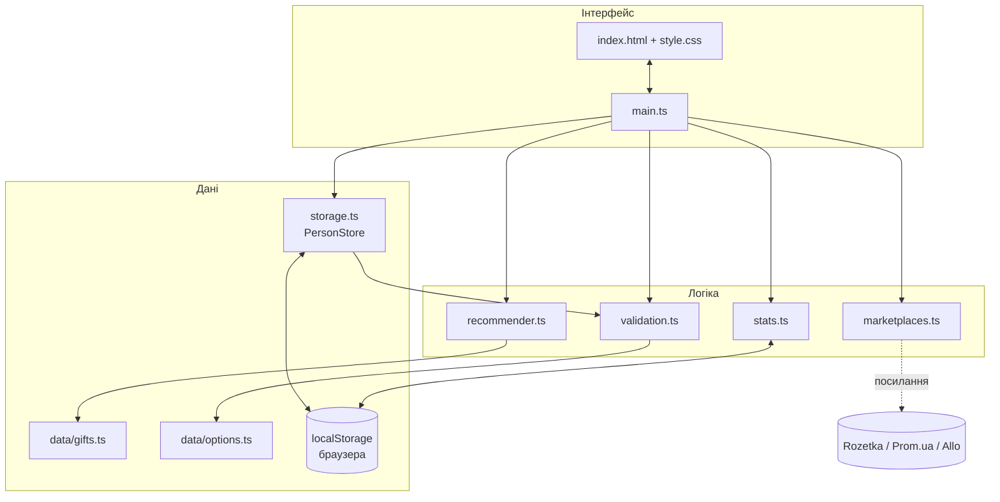
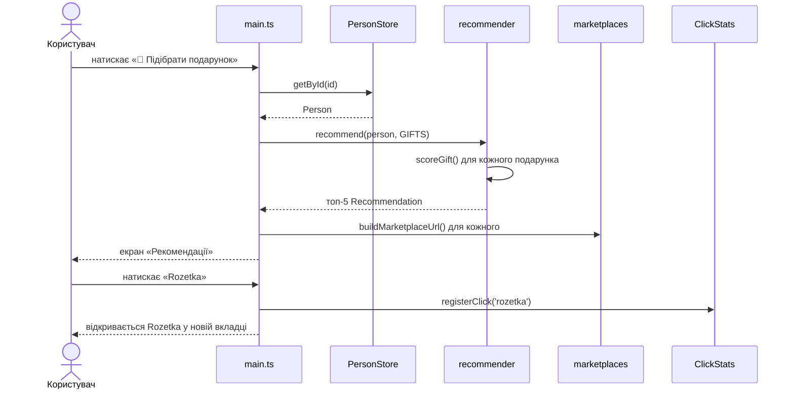

# Практична робота №11. Архітектура та структура програмного проєкту

## Мета

Навчитися організовувати структуру програмного проєкту та розподіляти його функціональність між окремими компонентами.

## Хід роботи

### 1. Структура проєкту

```
gift-match/
├── index.html              # розмітка сторінки (3 екрани)
├── package.json            # залежності і команди npm
├── tsconfig.json           # налаштування TypeScript
├── .gitignore
├── README.md
├── docs/                   # звіти з практичних, User Manual, презентація
│   └── screenshots/
├── src/
│   ├── main.ts             # інтерфейс: події, відображення
│   ├── style.css           # стилі
│   ├── types.ts            # типи даних
│   ├── storage.ts          # PersonStore + sortPeople
│   ├── validation.ts       # validatePerson
│   ├── recommender.ts      # алгоритм підбору, коефіцієнти
│   ├── marketplaces.ts     # маркетплейси і посилання
│   ├── stats.ts            # ClickStats, getTopHobby
│   ├── utils.ts            # escapeHtml (додано під час виправлення BUG-3)
│   └── data/
│       ├── gifts.ts        # каталог подарунків (50 шт.)
│       └── options.ts      # списки хобі, професій, обмеження
└── tests/                  # автоматичні тести (Vitest)
```

### 2. Розподіл функціональності за модулями

Я розділив програму на 3 рівні (шари):

| Шар | Модулі | Що робить |
|---|---|---|
| **Інтерфейс** | `main.ts`, `index.html`, `style.css` | показує дані, реагує на кнопки |
| **Логіка** | `recommender.ts`, `validation.ts`, `marketplaces.ts`, `stats.ts` | підбір, перевірка, посилання, статистика |
| **Дані** | `storage.ts`, `data/gifts.ts`, `data/options.ts` | зберігання людей, каталог, довідники |

`types.ts` використовують усі шари.

### 3. Відповідальність компонентів

| Модуль | Відповідає за | НЕ відповідає за |
|---|---|---|
| `main.ts` | HTML, події, перемикання екранів | розрахунок балів, збереження |
| `recommender.ts` | бали і топ-5 | HTML, localStorage |
| `validation.ts` | правила для полів | показ помилок на екрані |
| `storage.ts` | CRUD, пошук, імпорт/експорт, localStorage | HTML |
| `marketplaces.ts` | адреси маркетплейсів, партнерська мітка | відкриття вкладок |
| `stats.ts` | лічильники переходів, популярне хобі | малювання діаграми |

### 4. Взаємодія між компонентами

**Архітектурна схема:**



**Послідовність дій при підборі подарунка:**



### 5. Створення початкової структури проєкту

Початкову структуру я зробив у гілці `feature/project-structure`:

```bash
git checkout -b feature/project-structure
npm init -y
npm install -D typescript vite vitest
```

Додав `tsconfig.json` (з `"strict": true`, щоб TypeScript сам шукав помилки), `index.html` з розміткою трьох екранів, `src/types.ts` з інтерфейсами і файли-заготовки для кожного модуля з коментарем `// TODO`. Перевірив, що проєкт збирається:

```bash
npx tsc && npx vite build
# ✓ built in 88ms
```

Коміт: «Початкова структура проєкту: Vite + TypeScript, типи, модулі-заготовки».

Команди в `package.json`:

| Команда | Що робить |
|---|---|
| `npm run dev` | запускає сайт локально з автооновленням |
| `npm run build` | перевіряє типи і збирає сайт у папку `dist/` |
| `npm run preview` | показує зібрану версію |
| `npm test` | запускає автотести |

### 6. Обґрунтування рішень

1. **Vite** — простий у налаштуванні, сам розуміє TypeScript, швидко запускається.
2. **Без фреймворків (React, Vue)** — я їх ще не вивчав, а для 3 екранів вистачає звичайного TypeScript і DOM.
3. **Шари** — логіку можна тестувати окремо від інтерфейсу (практична №16), і якщо колись замінити localStorage на сервер, треба буде змінити тільки `storage.ts`.
4. **Окремі файли для даних** (`gifts.ts`, `options.ts`) — щоб додати подарунок, не треба лізти в код алгоритму.
5. **TypeScript strict** — помилки типу «забув передати поле» видно ще до запуску.

## Результат

Архітектурна схема + початкова структура проєкту в репозиторії.

## Висновок

Я навчився ділити програму на модулі з чіткою відповідальністю. Найбільше мені сподобалось, що алгоритм підбору нічого не знає про інтерфейс — тому його було легко тестувати.
