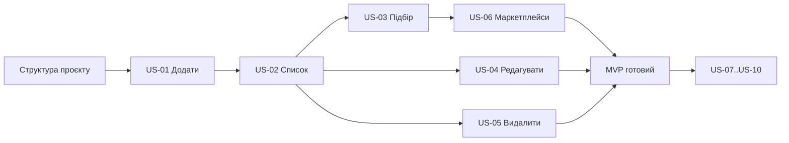

# Практична робота №12. Планування розробки та створення MVP

## Мета

Навчитися визначати мінімальний набір функцій, необхідний для першої робочої версії продукту.

## Хід роботи

### 1. Аналіз backlog

Backlog з практичної №5 (10 User Stories):

| ID | Коротко | Пріоритет | Оцінка |
|---|---|---|---|
| US-01 | Додати людину | Must | 3 |
| US-02 | Переглянути список | Must | 1 |
| US-03 | Підібрати подарунок (топ-5) | Must | 5 |
| US-04 | Редагувати людину | Must | 2 |
| US-05 | Видалити людину | Must | 1 |
| US-06 | Перейти на маркетплейс | Must | 2 |
| US-07 | Пошук | Should | 1 |
| US-08 | Сортування | Could | 1 |
| US-09 | Статистика переходів | Could | 2 |
| US-10 | Експорт / імпорт | Could | 3 |

Оцінка — у «сторі-поінтах» (умовна складність: 1 — дуже легко, 5 — найважче). Найскладніша US-03, бо там алгоритм і каталог подарунків.

### 2. Визначення MVP

**MVP (Minimum Viable Product)** — найменша версія, яка вже вирішує головну проблему користувача.

Головна проблема — «не знаю, що подарувати». Значить, у MVP обов'язково має бути: ввести дані про людину → отримати подарунки → перейти в магазин (бо так продукт заробляє).

**MVP GiftMatch = US-01 … US-06** (усі Must).

### 3. Обов'язкові функції (MVP)

- форма додавання людини з перевіркою даних;
- збереження в localStorage;
- список людей;
- редагування і видалення (без них користувач не зможе виправити помилку у введених даних);
- алгоритм підбору з коефіцієнтами + каталог подарунків;
- кнопки маркетплейсів з партнерською міткою.

### 4. Додаткові функції (після MVP)

- пошук (US-07);
- сортування (US-08);
- статистика переходів (US-09);
- експорт / імпорт (US-10).

### 5. Розбиття User Stories на задачі

**US-01 Додати людину**
- T1.1 Описати тип `Person` у `types.ts`
- T1.2 Зробити списки хобі і професій (`options.ts`)
- T1.3 Зробити форму в `index.html`
- T1.4 Написати `validatePerson()`
- T1.5 Зробити клас `PersonStore` з `load()`, `add()`, `save()`
- T1.6 Показати помилки під формою
- T1.7 Перевірити вручну

**US-02 Список**
- T2.1 Функція `renderPeople()` — картки людей
- T2.2 Текст для порожнього списку

**US-03 Підбір подарунків**
- T3.1 Тип `Gift`, `Recommendation`
- T3.2 Заповнити каталог (≈50 подарунків)
- T3.3 Константа `WEIGHTS`
- T3.4 Функція `scoreGift()` (хобі, вік, професія, стать)
- T3.5 Функція `recommend()` (сортування, топ-5)
- T3.6 Екран «Рекомендації» з відсотками і причинами

**US-04 Редагувати**
- T4.1 `PersonStore.update()`, `getById()`
- T4.2 Підставити дані у форму, кнопка «Зберегти зміни» / «Скасувати»

**US-05 Видалити**
- T5.1 `PersonStore.remove()`
- T5.2 Кнопка + `confirm()`

**US-06 Маркетплейси**
- T6.1 Список маркетплейсів і `buildMarketplaceUrl()` з UTM-міткою
- T6.2 Кнопки під кожним подарунком (нова вкладка)

### 6. Порядок виконання

Логіка порядку: спочатку дані (без людей нема кому підбирати), потім головна функція (підбір), паралельно — редагування/видалення.

### 7. План першої ітерації

**Ітерація 1 — «Перша робоча версія»** (практична №13)

| Задача | Результат |
|---|---|
| T1.1–T1.7 | можна додати людину з перевіркою |
| T2.1–T2.2 | люди видно у списку і після перезавантаження |
| Оновити README | є інструкція запуску |

**Критерій завершення ітерації:** я можу додати 2 людини, перезавантажити сторінку, і вони залишаються в списку. Неправильні дані не зберігаються.

**Ітерація 2 — «MVP»** (практична №14): US-03, US-06, US-04, US-05, а якщо залишиться час — US-07…US-10.

## Результат

MVP (US-01…US-06) + план реалізації з розбиттям на задачі.

## Висновок

Я зрозумів, що MVP — це не «недороблена програма», а найменша версія, яка вже корисна. Розбиття User Stories на маленькі задачі допомагає зрозуміти, з чого почати і скільки ще залишилось.
