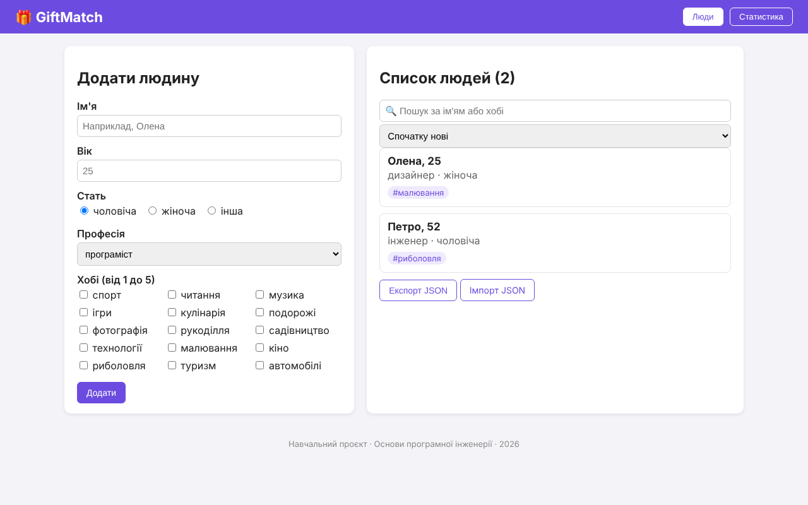

# Практична робота №13. Початок розробки програмного продукту

## Мета

Перейти від проєктування до практичної реалізації програмного продукту.

## Хід роботи

### 1. Структура проєкту

Структура вже створена в практичній №11 (гілка `feature/project-structure`). Для першої User Story я створив нову гілку:

```bash
git checkout main
git pull
git checkout -b feature/add-person
```

### 2. Базова логіка

**Типи даних** (`src/types.ts`):

```ts
export type Gender = 'male' | 'female' | 'other';

export interface Person {
  id: string;
  name: string;
  age: number;
  gender: Gender;
  profession: string;
  hobbies: string[];
  createdAt: number;
}

// Дані з форми (без id і дати, їх створює програма)
export type PersonData = Omit<Person, 'id' | 'createdAt'>;
```

**Збереження** (`src/storage.ts`) — клас `PersonStore`. Головне тут — `load()` не «падає», якщо в localStorage щось зіпсоване:

```ts
load(): string | null {
  const raw = localStorage.getItem(this.storageKey);
  if (!raw) {
    this.people = [];
    return null;
  }
  try {
    const parsed = JSON.parse(raw);
    if (!Array.isArray(parsed)) {
      throw new Error('not array');
    }
    this.people = parsed;
    return null;
  } catch {
    // якщо хтось зіпсував дані - починаємо з порожнього списку
    this.people = [];
    return 'Збережені дані пошкоджені, список очищено.';
  }
}
```

**Перевірка даних** (`src/validation.ts`) — функція повертає масив помилок, щоб показати всі помилки одразу, а не по одній:

```ts
export function validatePerson(data: PersonData): string[] {
  const errors: string[] = [];

  const name = data.name.trim();
  if (name.length < 2 || name.length > 50) {
    errors.push("Ім'я має містити від 2 до 50 символів");
  }
  // ... вік, стать, професія, хобі
  return errors;
}
```

### 3. Реалізація першої User Story (US-01 «Додати людину»)

У `main.ts`:
1. `fillFormOptions()` — заповнює список професій і чекбокси хобі з `options.ts`.
2. `readForm()` — збирає дані з форми в об'єкт `PersonData`.
3. При натисканні «Додати»: перевірка → якщо є помилки, показати їх → інакше `store.add()` і оновити список.
4. `renderPeople()` — малює картки людей.

```ts
form.addEventListener('submit', (event) => {
  event.preventDefault();
  const data = readForm();
  const errors = validatePerson(data);

  if (errors.length > 0) {
    showErrors(errors);
    return;
  }

  data.name = data.name.trim();
  store.add(data);
  showMessage('Людину додано');
  clearForm();
  renderPeople();
});
```

Коміт: «US-01: додавання людини (форма, перевірка даних, збереження в localStorage, список)».

### 4. Перевірка роботи програми

```bash
npm run dev
```

Що я перевірив вручну:

| Що робив | Результат |
|---|---|
| Додав «Олена, 25, жіноча, дизайнер, малювання» | ✅ з'явилась у списку |
| Додав «Петро, 52, чоловіча, інженер, риболовля» | ✅ з'явився |
| Перезавантажив сторінку (F5) | ✅ обидва залишились |
| Ім'я «А» | ✅ помилка «Ім'я має містити від 2 до 50 символів» |
| Не обрав хобі | ✅ помилка «Оберіть хоча б одне хобі» |
| Ім'я «   Ірина   » (з пробілами) | ❌ збереглось з пробілами |

Перша версія програми:



> Поле пошуку, сортування і кнопки експорту/імпорту вже є в розмітці (з практичної №11), але в цій версії вони ще не працюють — це наступні ітерації.

### 5. Виправлення помилок

**Помилка:** якщо ввести ім'я з пробілами на початку або в кінці, перевірка проходила (бо в перевірці я робив `trim()`), але зберігалось ім'я разом з пробілами.

**Виправлення:** перед збереженням прибираю пробіли — рядок `data.name = data.name.trim();`.

Коміт: «fix: прибираємо пробіли на початку і в кінці імені перед збереженням».

### 6. Commit

```bash
git add .
git commit -m "fix: прибираємо пробіли на початку і в кінці імені перед збереженням"
git checkout main
git merge --no-ff feature/add-person
git tag -a v0.1.0 -m "Перша робоча версія: додавання людей"
git push --follow-tags
```

### 7. Оновлення README

Додав розділ «Як запустити» (`npm install`, `npm run dev`) і статус «Зараз працює додавання людей у список». Коміт: «README: інструкція запуску».

## Результат

Перша робоча версія продукту — **v0.1.0**: можна додавати людей, дані перевіряються і зберігаються.

## Висновок

Я перейшов від документів до коду. Зрозумів, що навіть у маленькій функції є помилки, які видно тільки при перевірці (пробіли в імені). Добре, що User Story мала критерії приймання — я одразу знав, що перевіряти.
