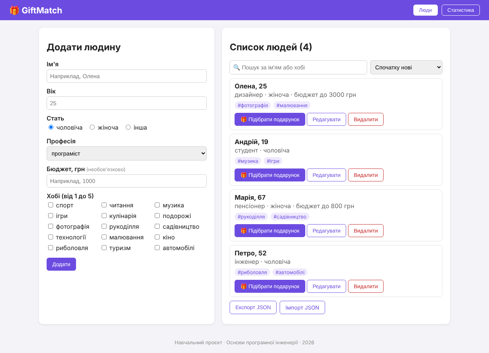
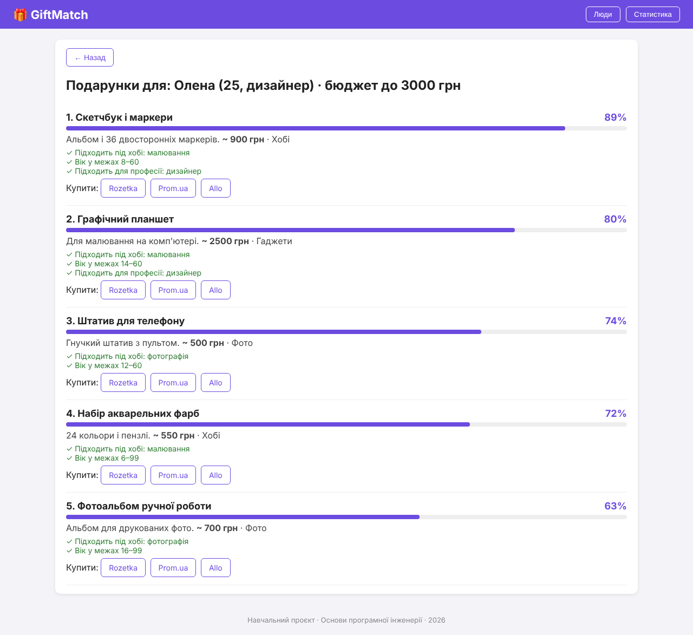

# Практична робота №14. Реалізація функціональності та інтеграція

## Мета

Закріпити навички реалізації функціональності та інтеграції командних змін.

## Хід роботи

### 1. Вибрані User Stories

| Гілка | User Stories |
|---|---|
| `feature/recommendations` | US-03 Підібрати подарунок, US-06 Перейти на маркетплейс |
| `feature/edit-delete` | US-04 Редагувати, US-05 Видалити |
| `feature/search-sort` | US-07 Пошук, US-08 Сортування |
| `feature/stats-export` | US-09 Статистика, US-10 Експорт/імпорт |

Головні — перші дві (це закінчує MVP). Дві останні я встиг зробити в цій же ітерації.

### 2. Реалізація функціональності

#### US-03: алгоритм підбору (`src/recommender.ts`)

Кожна характеристика дає оцінку від 0 до 1, потім множиться на свій коефіцієнт:

```
бал = 0.45 × хобі + 0.25 × вік + 0.20 × професія + 0.10 × стать
```

| Характеристика | Як рахується оцінка |
|---|---|
| Хобі | 1 збіг → 0.8; 2 і більше → 1.0; немає збігів → 0; подарунок універсальний (без хобі) → 0.3 |
| Вік | у межах `minAge…maxAge` → 1; до 5 років за межами → 0.5; інакше → 0 |
| Професія | збіг → 1; подарунок для всіх професій → 0.3; інакше → 0 |
| Стать | підходить або подарунок для всіх → 1; інакше → 0 |

Результат × 100 і округлюється — виходить відсоток.

**Приклад.** Олена, 25 років, дизайнер, хобі: малювання, фотографія. Подарунок «Скетчбук і маркери» (хобі: малювання; професії: дизайнер, студент; вік 8–60; для всіх):

```
хобі:      1 збіг           → 0.8 × 0.45 = 0.36
вік:       25 в межах 8–60  → 1   × 0.25 = 0.25
професія:  дизайнер         → 1   × 0.20 = 0.20
стать:     для всіх         → 1   × 0.10 = 0.10
                                    сума = 0.91 → 91%
```

> **Примітка:** це перша версія алгоритму (v0.2.0). У версії 1.1.1 формулу оцінок хобі, віку і професії уточнено, бо багато подарунків отримували однаковий відсоток (BUG-5, див. практичну №18). Коефіцієнти залишились ті самі.

Функція `recommend()` рахує бал для всіх подарунків, прибирає ті, де бал 0, сортує від більшого до меншого і бере перші 5.

Біля кожного подарунка є причини, чому він підходить: «Підходить під хобі: малювання», «Вік у межах 8–60», «Підходить для професії: дизайнер».

#### US-06: маркетплейси (`src/marketplaces.ts`)

```ts
export const MARKETPLACES: Marketplace[] = [
  { id: 'rozetka', name: 'Rozetka', searchUrl: 'https://rozetka.com.ua/ua/search/?text=' },
  { id: 'prom', name: 'Prom.ua', searchUrl: 'https://prom.ua/ua/search?search_term=' },
  { id: 'allo', name: 'Allo', searchUrl: 'https://allo.ua/ua/catalogsearch/result/?q=' },
];

const PARTNER_PARAMS = 'utm_source=giftmatch&utm_medium=referral&utm_campaign=gift_recommendation';

export function buildMarketplaceUrl(marketplace: Marketplace, query: string): string {
  return marketplace.searchUrl + encodeURIComponent(query) + '&' + PARTNER_PARAMS;
}
```

`encodeURIComponent` потрібен, бо в назві є кирилиця і пробіли. UTM-мітка показує маркетплейсу, що покупець прийшов від GiftMatch (так продукт заробляє). У реальному проєкті замість UTM був би ID з партнерської програми маркетплейсу.

#### US-04, US-05: редагування і видалення

- `PersonStore.update(id, data)` — змінює запис, але `id` і дату додавання залишає старі.
- `PersonStore.remove(id)` — видаляє.
- Кнопка «Редагувати» підставляє дані у форму, заголовок стає «Редагувати: Олена», кнопка — «Зберегти зміни», з'являється «Скасувати».
- Кнопка «Видалити» питає `confirm('Видалити Олена?')`.

#### US-07…US-10

- `PersonStore.search(query)` — пошук за ім'ям або хобі;
- `sortPeople(people, mode)` — сортування за ім'ям (з українським алфавітом, `localeCompare(..., 'uk')`), віком, датою;
- клас `ClickStats` — рахує натискання на кнопки маркетплейсів, зберігає в localStorage;
- `getTopHobby()` — найпопулярніше хобі;
- `exportJson()` / `importJson()` — файл `giftmatch-people.json`. Імпорт спочатку перевіряє **всі** записи, і тільки якщо всі правильні — додає. Тому неправильний файл не псує список.

### 3. Локальне тестування

Після кожної гілки я запускав `npm run build` (перевірка типів) і перевіряв у браузері:

| Перевірка | Результат |
|---|---|
| Олена (дизайнер, малювання) → «Підібрати» | ✅ топ-5, перші — «Скетчбук і маркери» 91% і «Графічний планшет» 91% |
| Відсотки йдуть від більшого до меншого | ✅ |
| Кнопка «Rozetka» → у посиланні назва і `utm_source=giftmatch` | ✅ |
| Редагувати вік 25 → 30 | ✅ змінився, людей стільки ж |
| Видалити → OK | ✅ зникла |
| Сортування за віком | ✅ |
| Імпорт файлу `{"hello": 1}` | ✅ «Файл має неправильний формат», список не змінився |

### 4. Commits

```
US-03, US-06: каталог подарунків, алгоритм підбору з коефіцієнтами, посилання на маркетплейси
US-04, US-05: редагування і видалення людини
US-07, US-08: пошук за ім'ям або хобі, сортування списку
US-09, US-10: статистика переходів, експорт та імпорт JSON, адаптивність для телефону
```

### 5. Pull Requests / злиття

Оскільки я працюю сам, гілки цієї практичної я зливав у `main` локально командою `git merge --no-ff` — це таке саме злиття з окремим merge-комітом, яке робить кнопка «Merge pull request» на GitHub. Повний процес з Pull Request і code review на GitHub показаний у практичній №10.

### 6. Інтеграція

Гілки `feature/recommendations` і `feature/edit-delete` я робив **паралельно** від однієї версії `main`. Першу злив без проблем, а друга дала конфлікт.

### 7. Вирішення конфліктів

```
$ git merge --no-ff feature/edit-delete
Auto-merging src/main.ts
CONFLICT (content): Merge conflict in src/main.ts
Auto-merging src/storage.ts
Auto-merging src/style.css
CONFLICT (content): Merge conflict in src/style.css
Automatic merge failed; fix conflicts and then commit the result.
```

**Чому:** обидві гілки додали кнопки в одне й те саме місце картки людини, і обидві додали обробник кліку по списку.

```
      <div class="person-buttons">
<<<<<<< HEAD
        <button ... data-action="recommend">🎁 Підібрати подарунок</button>
=======
        <button ... data-action="edit">Редагувати</button>
        <button ... data-action="delete">Видалити</button>
>>>>>>> feature/edit-delete
      </div>
```

**Як вирішив:**
- у картці залишив **усі три** кнопки;
- два обробники кліку об'єднав в один: спочатку шукаю людину за `id`, а потім перевіряю `data-action` (`recommend`, `edit` або `delete`);
- у `style.css` залишив обидва блоки стилів (рекомендації і червона кнопка видалення);
- `storage.ts` Git злив сам, бо метод `getById` був однаковий в обох гілках.

Коміт: «Merge branch 'feature/edit-delete' (вирішено конфлікти в main.ts і style.css)».

### 8. Перевірка спільної версії

Після злиття я ще раз прогнав усі перевірки з пункту 3 — все працює разом: можна додати, підібрати, відредагувати і видалити одну й ту саму людину. Версію позначив тегом **v0.2.0** («Функціональний прототип»).





> Скріншоти зроблені на фінальній версії (тому в формі вже є поле «Бюджет» з практичної №19).

## Результат

Функціональний прототип **v0.2.0**: усі 10 User Stories реалізовані.

## Висновок

Я реалізував основну функціональність і вперше вирішив конфлікт у коді. Конфлікт виник, бо дві гілки міняли одне місце. Висновок для себе: краще частіше зливати гілки в `main`, тоді конфлікти маленькі.
