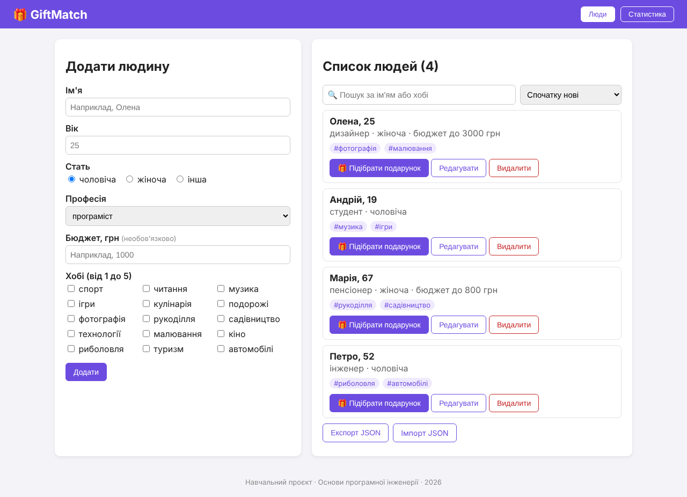
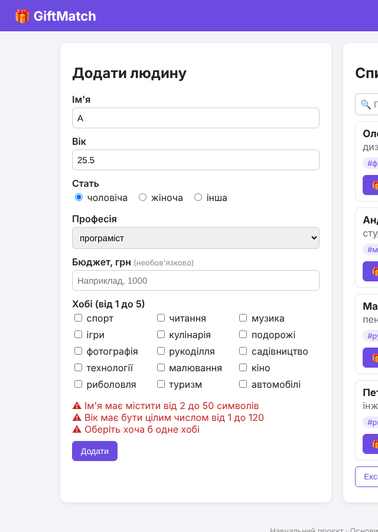
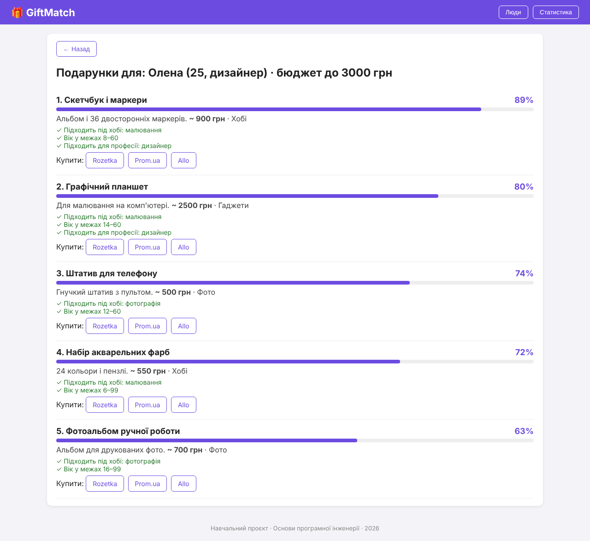
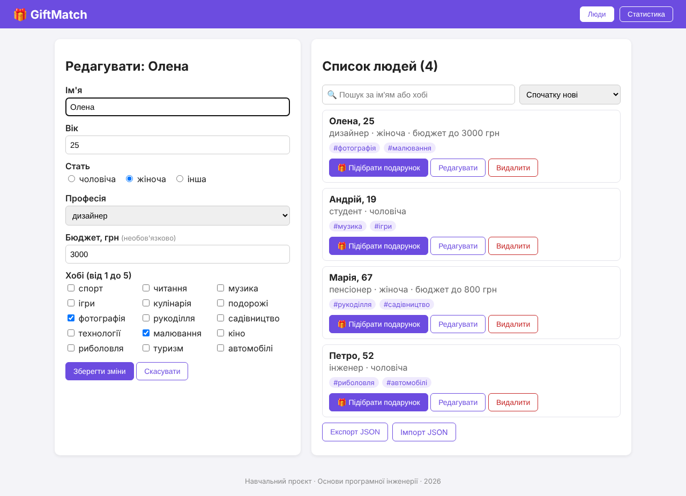
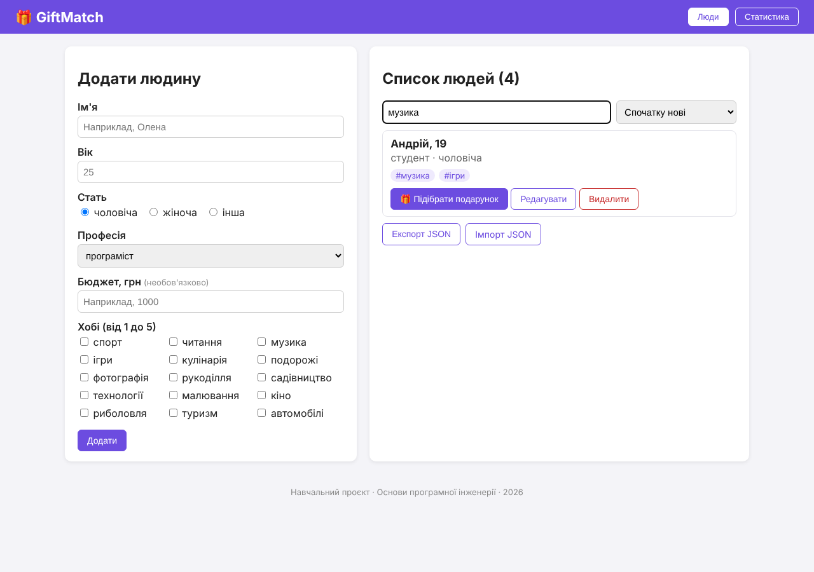
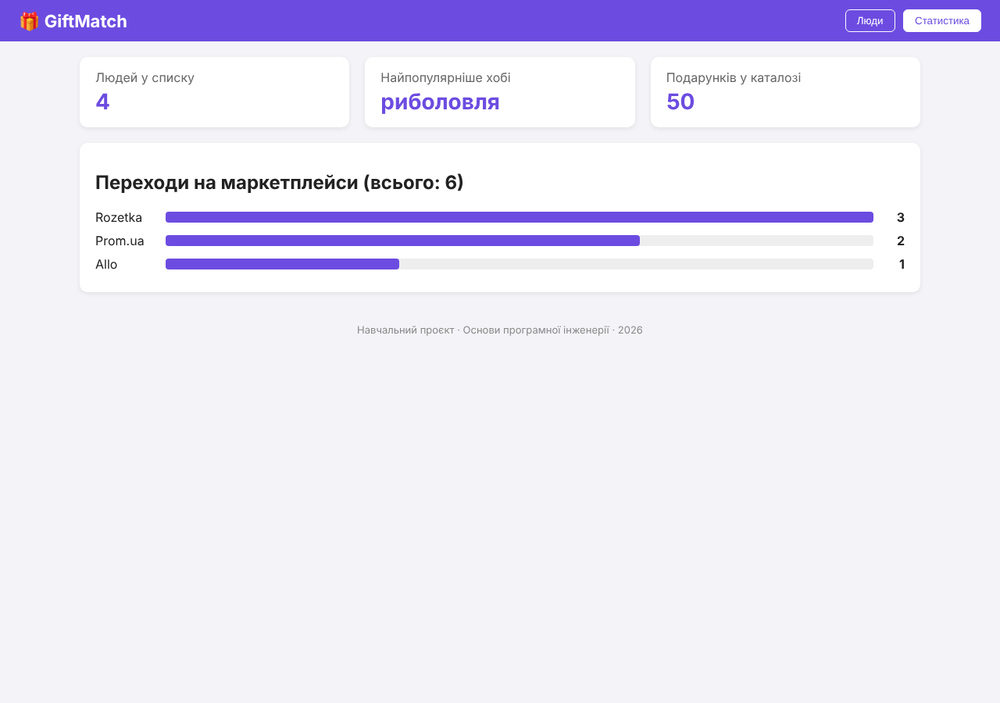
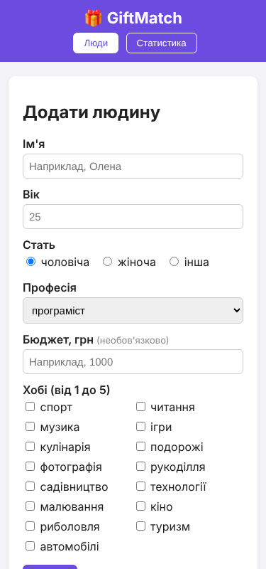

# GiftMatch — інструкція користувача

Версія 1.1.1

## Що вміє GiftMatch

GiftMatch допомагає вибрати подарунок. Ви додаєте людину (друга, родича, колегу) з її хобі, віком, статтю і професією, а програма показує 5 подарунків, які їй найбільше підходять, і кнопки, щоб купити їх у інтернет-магазині.

Реєстрація не потрібна. Усі дані зберігаються тільки у вашому браузері.

## Запуск

1. Встановіть [Node.js](https://nodejs.org/) (версія 18 або новіша).
2. Завантажте проєкт і відкрийте папку в терміналі.
3. Виконайте:
   ```bash
   npm install
   npm run dev
   ```
4. Відкрийте в браузері адресу з терміналу (зазвичай http://localhost:5173).

## Екрани

У шапці є два пункти меню: **Люди** і **Статистика**. Третій екран — **Рекомендації** — відкривається з картки людини.

## 1. Як додати людину



1. У формі зліва введіть **Ім'я** (від 2 до 50 символів).
2. Введіть **Вік** — ціле число від 1 до 120.
3. Оберіть **Стать**.
4. Оберіть **Професію** зі списку. Якщо потрібної немає — оберіть «інше».
5. За бажанням введіть **Бюджет** у гривнях (від 50 до 100000). Тоді програма покаже тільки подарунки, які вкладаються в цю суму.
6. Відмітьте від 1 до 5 **хобі**.
7. Натисніть **Додати**.

Людина з'явиться у списку праворуч.

Якщо щось введено неправильно, під формою з'являться червоні повідомлення, наприклад:



Виправте поля і натисніть «Додати» ще раз.

## 2. Як підібрати подарунок

1. На картці людини натисніть **🎁 Підібрати подарунок**.
2. Відкриється екран з п'ятьма подарунками:
   - відсоток — наскільки подарунок підходить (чим більше, тим краще);
   - опис, орієнтовна ціна і категорія;
   - зелені рядки ✓ — чому подарунок підходить;
   - кнопки **Rozetka**, **Prom.ua**, **Allo**.
3. Щоб повернутися до списку, натисніть **← Назад**.



**Як рахується відсоток:** найважливіше — хобі (45%), потім вік (25%), професія (20%) і стать (10%). Вищий відсоток отримують подарунки, які:
- підходять під кілька хобі людини одразу;
- присвячені саме її хобі (набір спецій — тільки про кулінарію, тому для любителя кулінарії він точніший, ніж колонка «для музики, подорожей і туризму»);
- розраховані на її вік (вік ближче до середини вікового діапазону подарунка);
- підходять для її професії.

Якщо подарунків не знайдено (наприклад, бюджет дуже малий), ви побачите «На жаль, нічого не знайдено» — спробуйте збільшити бюджет.

## 3. Як купити подарунок

Натисніть кнопку маркетплейсу під подарунком. У новій вкладці відкриється пошук цього товару на сайті магазину. Ціна в GiftMatch орієнтовна — актуальну ціну дивіться на сайті магазину.

> Якщо нова вкладка не відкрилась, дозвольте спливаючі вікна для цього сайту в налаштуваннях браузера.

## 4. Як змінити дані людини

1. На картці натисніть **Редагувати**.
2. Дані з'являться у формі, заголовок зміниться на «Редагувати: [ім'я]».
3. Змініть потрібні поля. Щоб прибрати бюджет — просто очистіть поле.
4. Натисніть **Зберегти зміни**.

Щоб передумати, натисніть **Скасувати**.



## 5. Як видалити людину

1. На картці натисніть **Видалити**.
2. Підтвердіть у вікні, натиснувши **OK** (або **Скасувати**, якщо передумали).

## 6. Пошук і сортування

- **Пошук:** почніть вводити ім'я або хобі в поле «🔍 Пошук за ім'ям або хобі». Великі і малі літери не важливі.
- **Сортування:** у списку поруч оберіть «Спочатку нові», «За ім'ям» або «За віком».



## 7. Статистика

Натисніть **Статистика** в меню. Тут видно:
- скільки людей у списку;
- найпопулярніше хобі;
- скільки подарунків у каталозі;
- скільки разів натискали на кожен маркетплейс.



## 8. Перенесення даних (експорт / імпорт)

Дані зберігаються тільки в цьому браузері. Щоб перенести список на інший комп'ютер:

1. Натисніть **Експорт JSON** — завантажиться файл `giftmatch-people.json`.
2. На іншому комп'ютері натисніть **Імпорт JSON** і оберіть цей файл.

Люди, які вже є у списку, не дублюються. Якщо файл пошкоджений, з'явиться повідомлення «Файл має неправильний формат», і ваш список не зміниться.

## 9. На телефоні

Сайт працює і на телефоні: форма і список розташовуються один під одним.



## Часті питання

**Дані зникли після очищення браузера.** Це нормально — дані зберігаються в браузері. Робіть експорт, щоб мати копію.

**З'явилось повідомлення «Збережені дані пошкоджені, список очищено».** Дані в браузері були змінені вручну або пошкоджені. Відновіть список з файлу експорту.

**Чому тільки 5 подарунків?** Так простіше вибрати. Щоб побачити інші варіанти, змініть хобі людини.
